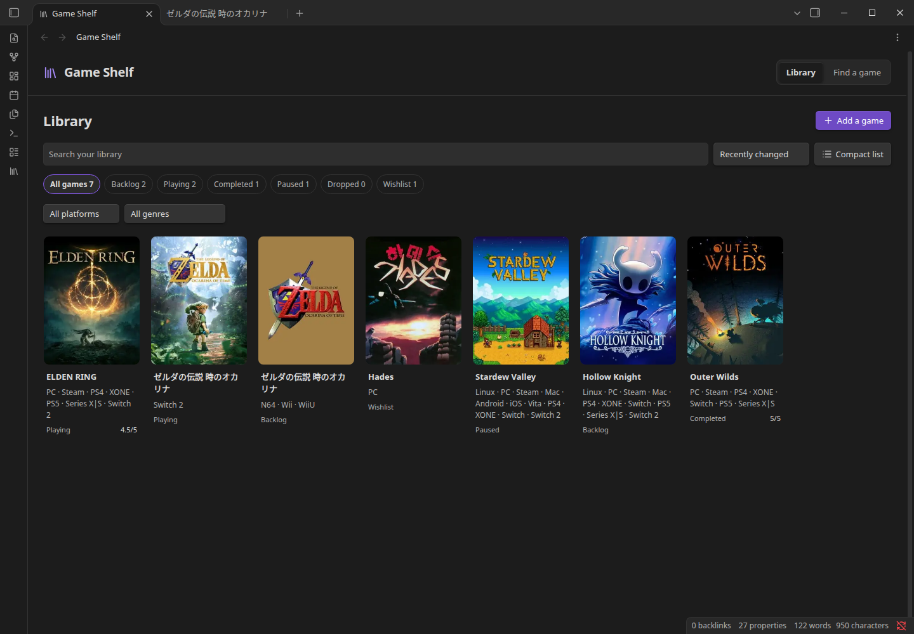
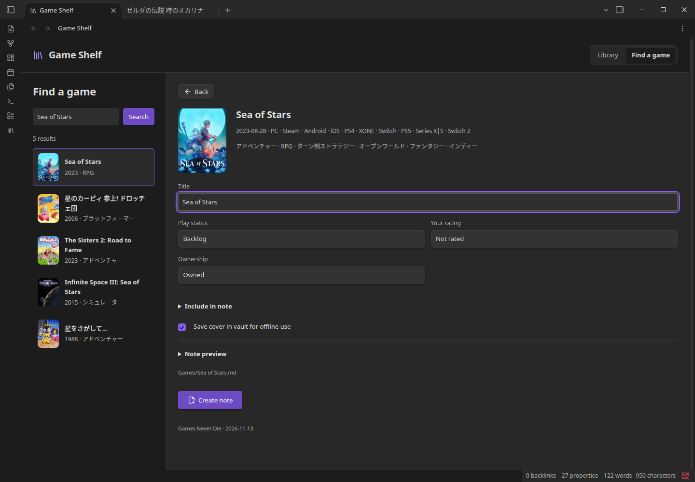
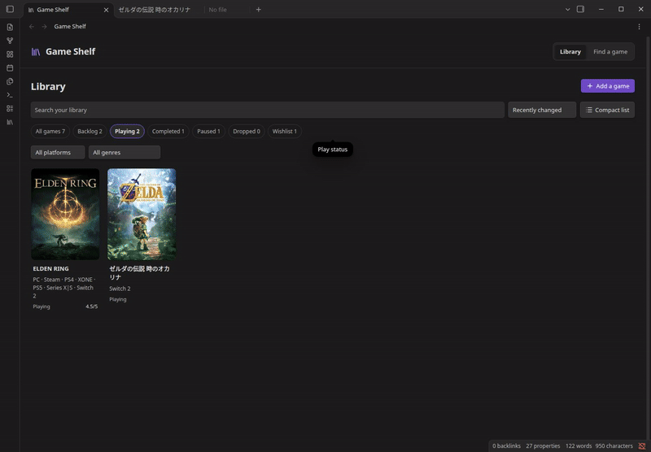
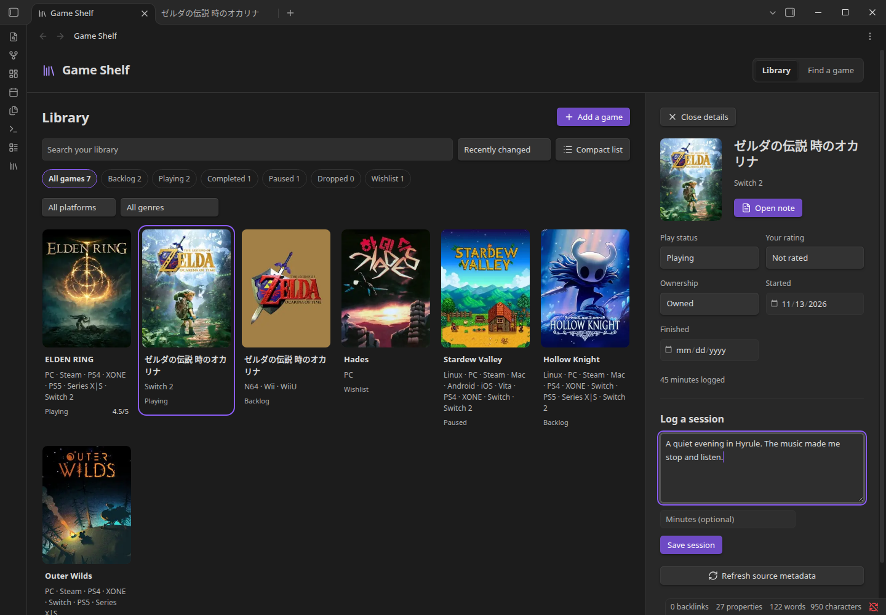

# Game Shelf

Find a game. Make a note. Remember why you played it.

Game Shelf brings game discovery, a local backlog, and personal play journals to
Obsidian. It creates ordinary Markdown notes using
[Games Never Die](https://gamesneverdie.com/ja) for Japanese game data or
[IGDB](https://www.igdb.com/) for English game data. IGDB requires your own
Twitch application Client ID and Client Secret. No plugin server, Python
installation, Dataview, or other plugin is required. Manual notes work offline.



## A library and a place to write

- **Find the right edition.** Japanese/English search and direct game URLs, with
  covers, dates and platform labels before you create anything.
- **Choose your information.** Basic metadata, ratings, store links, overview,
  articles, media, and optional Steam data. Overviews and articles are off by
  default because they can contain spoilers.
- **Keep your collection local.** Cover grid or compact list, local search,
  platform/genre filters, play statuses, ownership and a personal 0–5 rating.
- **Keep a play journal.** Dated entries and optional session minutes go into
  the note itself. The total is a normal property. Freeform writing belongs in
  the same file, alongside links, guides, screenshots and anything else you keep.
- **Refresh with a review.** Compare incoming source properties with the current
  note. User-edited values are unselected. Updates preserve your body, status,
  rating, journal, custom properties and YAML comments.
- **Bring your own structure.** Vault folders, filename templates, Markdown
  templates, property names and status identifiers are configurable.
- **Work offline.** Manual notes, library filters, personal metadata and journals
  need no network. Covers can be saved inside your vault.

The interface follows your Obsidian theme and supports English and Japanese,
keyboard operation and narrow panes. There are no default hotkeys.
Choose the language of new notes separately from the interface. Automatic
source selection uses Games Never Die for Japanese notes and IGDB for English
notes. Saved notes retain their writing language and original source.



## Demo

The recording below is the real plugin running in an isolated Obsidian vault,
not a browser mockup. Library content uses live game lookups; personal notes are
demonstration text.



[Watch or download the MP4](docs/media/demo.mp4).

## Install

1. In Obsidian, open **Settings → Community plugins**.
2. If prompted, select **Turn on community plugins**.
3. Select **Browse**, search for **Game Shelf**, and open its listing.
4. Select **Install**, then **Enable**.

<details>
<summary>Manual installation</summary>

1. Download `main.js`, `manifest.json` and `styles.css` from the
   [latest release](https://github.com/tetsuya-dev-jp/obsidian-game-shelf/releases/latest).
2. Create `<your vault>/<your config folder>/plugins/game-shelf/` and put the
   three files there. The config folder is normally `.obsidian`; custom config
   folders also work.
3. Reload Obsidian and enable **Game Shelf** in Community plugins.

</details>

## Start with one game

1. Open **Game Shelf** from the ribbon or run **Game Shelf: Find and add a game**.
2. Choose your new-note language in Game Shelf settings. For English game data,
   select **Set up IGDB credentials** and follow the guide, or use the
   [written setup instructions](docs/igdb-setup.md).
3. Enable online search after reading the service disclosure. Search a title or
   paste a game URL from your selected source.
4. Check the date/platform and choose your play status and optional rating.
5. Choose which source information to include, and whether to save the cover
   offline. Open **Note preview** if you want to inspect the template.
6. Select **Create note**. The note opens in Obsidian; its ordinary Markdown
   remains useful if you disable or remove Game Shelf.

Games Never Die supplies Japanese metadata; IGDB supplies its original game
data, generally in English. Neither source guarantees a translated name or
description for every game. Imported text is not machine-translated. The note
preview shows what will be saved. Choosing a source whose data language differs
from your note language displays a notice; failed English lookups never silently
switch to Japanese. GND articles and its optional Steam statistics are not
available from IGDB.

**Already added?** The existing note is offered instead of being overwritten.
Different source editions have different IDs; colliding filenames get a
year/platform suffix. Manual entries also never overwrite an existing file.
IDs are source-specific. An IGDB record and a GND record are not automatically
merged even when their titles match; remakes, editions and ports may differ.

## Organize and remember

In **Library**, filter by play status, platform or genre. Search is local. Switch
between covers and a compact list, or sort by title, recent changes or your rating.
Choose a game to edit status, ownership, rating and dates, or open its note.

**Log a session** writes a dated entry under the play-log marker and adds the
optional minutes to `playtime_minutes`. Prior entries and freeform writing are
preserved. Draft text survives switching games in that shelf view; select
**Save session** to persist it. Unsaved drafts are not guaranteed after closing
the view or restarting Obsidian.

The default template contains `<!-- game-shelf:journal -->`. Keep this line if
you want the session form to find the play log. Removing it does not remove any
writing; the form asks you to restore the marker before saving a new entry.



## Source refresh is separate from your writing

Choose **Refresh source metadata** from a saved game's detail panel. Review
each changed property before applying it:

- A value matching the last import is selected by default.
- A value edited in the note is marked as a conflict and left unselected.
- Without import history, nonempty existing values are treated as conflicts.
- Personal status/rating/ownership/dates and the note body are never source
  refresh targets. Selected fields are checked again when saving, so a note
  edited after the preview is not silently overwritten.

Refresh updates properties, not the overview/article/media body produced at
creation. This protects edited prose and links. Newer source details remain
available from the source-page link or a new preview.

## Templates and properties

Settings are searchable in current Obsidian. English online lookups require
IGDB credential setup; local writing and Japanese GND lookups do not.

| Setting | Default / supported values |
| --- | --- |
| Notes folder | `Games` |
| Interface language | Match Obsidian, English, Japanese |
| New-note language | Match interface, English, Japanese |
| Game data source | Automatic by note language, Games Never Die, IGDB |
| IGDB Client ID | Your public Twitch application ID |
| IGDB Client Secret | A reference selected with Obsidian SecretStorage |
| Local cover folder | `Games/Attachments` |
| Filename | `{{title}}`; also `{{year}}`, `{{platform}}`, `{{slug}}` |
| Note template | `{{title}}`, `{{cover}}`, `{{source}}`, `{{notes_heading}}`, `{{journal_heading}}`, `{{journal_marker}}` |
| Personal status | `backlog`, `playing`, `completed`, `paused`, `dropped`, `wishlist`; add your own identifiers |
| Personal rating | Optional number from 0 to 5, in half-point steps in the UI |
| Property names | Optional JSON, e.g. `{"rating":"my_score","status":"play_status"}` |

Templates are plain Markdown with single-pass substitutions. Game Shelf does
not evaluate scripts or invoke Templater. Provider text is escaped when inserted
into a note. Your own template remains your responsibility if another plugin
processes it as code.

New installations include screenshots and trailers by default. Screenshots
appear as images separated by blank lines; trailers remain links. You can turn
them off under **Include in note**. Saved field selections and custom templates
are preserved. **Save cover in vault for offline use** saves only the cover;
screenshots use remote images with either cover setting and require a network
connection. Existing note bodies are not rewritten.

Property mappings apply to **new notes**. Existing notes keep the names used
when they were created; the plugin remembers their profiles in its local data.
It does not silently rename properties across your vault. Keep the plugin data
with your vault if you use custom profiles across devices.

Notes have readable properties such as `title`, `platforms`, `genres`,
`release_date`, `developers`, `status`, `ownership`, `rating`, `cover`, `started`,
`finished` and `playtime_minutes`. Source scores use `igdb_score` and
`steam_positive_pct`, separate from your personal rating. Source identity and
timestamps are included for duplicate detection and provenance. The
`game-shelf-note` CSS class keeps the generated cover compact; remove that class
from a note if you prefer your theme's default image sizing.

No dashboard dependency is required. These properties also remain available to
Obsidian Bases, Dataview, searches and your own scripts.

## Privacy, networking and upstream limits

Game Shelf sends **no vault text, personal ratings, play logs or telemetry** to a
service. Online search is initially off. There is no background crawling,
scheduled refresh, account sync, self-updater, advertising or analytics.

The local library lists Markdown file paths across the vault and checks
Obsidian's cached frontmatter for Game Shelf identities. This keeps game notes
discoverable after you move or rename them, including outside the creation
folder. Indexing does not read note bodies; only recognized game notes enter
the library. The index stays in memory and is updated by vault events. File
paths and cached properties are not sent to the game provider.

Online use allows searches, game lookups, connection tests and remote artwork previews:

| Destination | Purpose |
| --- | --- |
| `gamesneverdie.com` | Search terms, game pages and optional `/api/steam` lookups |
| `media.gamesneverdie.com` | Cover previews, screenshot images and optional local cover downloads |
| `id.twitch.tv` | Exchange your IGDB application credentials for an access token |
| `api.igdb.com` | English game searches, details and explicit connection tests |
| `images.igdb.com` | IGDB cover previews, screenshots and optional local cover downloads |

The note can contain external store, article and YouTube links and embedded
screenshot images. Remote screenshots load when the note is rendered.
Game Shelf does not open those pages or fetch article bodies automatically.
Remote cover previews can load when shown. Library covers saved in the vault
are local; turn online search off to suppress remote-cover fallbacks.

GND requests are spaced by at least one second, deduplicated in flight and cached
in memory for the plugin session (games: 24h; search: 1h; Steam: 5min). Caches are
bounded and can be cleared in settings. HTTP failures are explicit and not
automatically retried. The network timeout is 20 seconds; cover downloads are
limited to 3 MiB and supported image signatures are verified before saving.
IGDB requests are serialized at least 250 ms apart. Responses are cached in
memory (games: 24h; searches: 1h), with bounded caches and concurrent-request
deduplication. An expired token is renewed; one 401 response triggers one
reauthentication attempt. Rate limits and other failures are not automatically
retried. Tokens are held only in memory and never saved in notes or plugin data.

The Client ID is public and saved in plugin settings. The Client Secret is read
from Obsidian SecretStorage; plugin settings save only its reference, not its
value. SecretStorage is scoped to the vault and is not an assurance of encrypted
storage. Protect your devices and backups. Synced settings may contain a secret
reference without the secret; configure it on each device when necessary.

Each new note stores its writing language independently of the interface and
future defaults. For notes created before 1.1.0, choose **Note writing language**
in the library detail before adding another play-log entry. This choice saves
only the language property; it does not translate or rewrite existing prose.

[The site's disclaimer](https://gamesneverdie.com/ja/disclaimer) asks users to
refrain from automated bulk extraction; its
[robots.txt](https://gamesneverdie.com/robots.txt) excludes search and API paths
from crawling. This plugin is for individual, user-initiated lookups and offers
no bulk crawler or automatic pagination. Rate limits and caching do not grant
permission for bulk collection. The unofficial, unversioned source may change
or stop working; existing notes and offline features remain local.

Plugin settings, property-name profiles and import baselines are stored through
Obsidian's plugin data API inside your vault configuration folder. Game Shelf
does not access files outside the vault. The bundled YAML parser is used to
preserve comments while atomically updating properties and journal text.

## Compatibility and verification

Requires Obsidian **1.13.7+**. The plugin uses browser-safe APIs and declares
mobile compatibility; actual native desktop tests and narrow-pane checks are
recorded in [verification](docs/verification.md). Native iOS/Android execution
is reported separately and must not be inferred from desktop viewport tests.

Offline tests cover parsing, input validation, templates, script-safe source
text, cache behavior and conflict handling. Native acceptance checks create and
read real notes through Obsidian, inspect its own metadata cache, decode saved
covers, test duplicate/edition handling and protect concurrent edits.

User research and the decisions it informed:
[17 first-person threads and issues](docs/user-research.md). This was a
qualitative scan, not a representative survey or usability study of this plugin.

## Development

Node.js 24 and npm:

```sh
npm ci
npm run check
```

The bundled release consists of `main.js`, `manifest.json` and `styles.css`.
No Node.js process or additional software is needed by plugin users.

Linux native test harness:

```sh
OBSIDIAN_BINARY=/path/to/extracted/AppRun node e2e/launch.mjs start
node e2e/acceptance.mjs --live
node e2e/launch.mjs stop
```

The harness uses a dedicated test vault/profile and stops only its own process
group. `--live` explicitly opts into the upstream search checks; see the test
script's fixture prerequisites. Do not point it at a personal vault.

## License and attribution

MIT; see [LICENSE](LICENSE) and [third-party notices](THIRD_PARTY_NOTICES.md).
The Games Never Die adapter derives from our MIT-licensed
[gamesneverdie-client](https://github.com/tetsuya-dev-jp/gamesneverdie-client).
Other plugins were researched as references; their code was not copied.

This is an independent community plugin, not an official Obsidian, Nintendo,
IGDB, Steam or Games Never Die product. Game artwork and source text belong to
their respective rights holders. Screenshots show real application behavior and
do not license the underlying game art for other uses.
